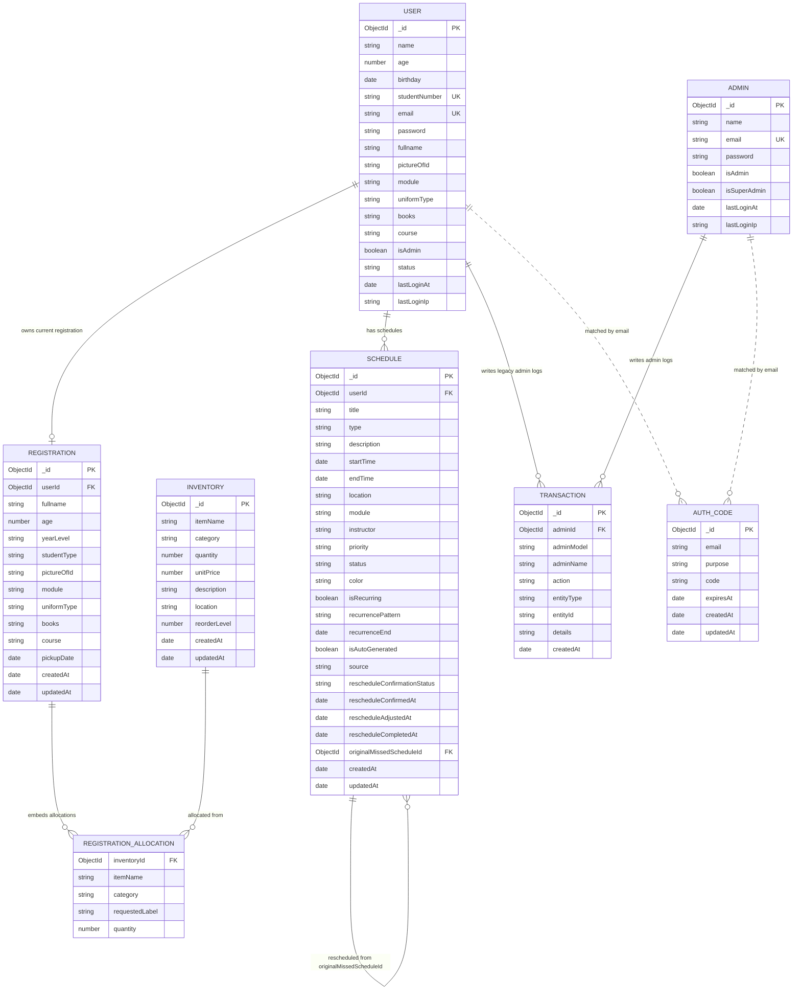

# MongoDB ERD

This project uses MongoDB, so the diagram below shows logical relationships between collections and embedded subdocuments rather than SQL foreign-key constraints.

## Mermaid ERD

## Notes

- `REGISTRATION_ALLOCATION` is an embedded array inside the `Registration` document, not a separate MongoDB collection.
- `AuthCode` is linked to `User` and `Admin` by `email`, not by `ObjectId`.
- `Transaction.adminId` is polymorphic through `adminModel`, so it can reference either `Admin` or a legacy admin stored in `User`.
- `User -> Registration` behaves like one-to-zero-or-one in service logic, although the schema does not enforce a unique index on `Registration.userId`.
- `Schedule.originalMissedScheduleId` is a self-reference used for reschedule history.
